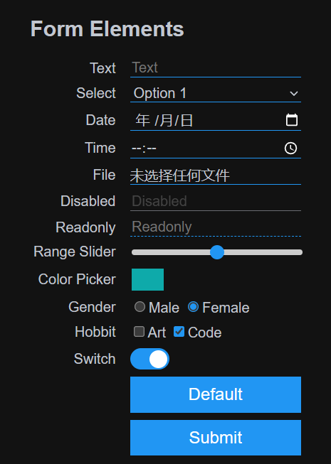

# materia

class-less css ui framework for resource constrained MCU.

## Goals

considering the reources constrained in embedded system(resource constrained MCU), 
this framwork not aimed at full functionity, beautiful, interactive;
but concentrate on 
- minimal size (about 0.8KB after gzip)
- compact layout (more than 20 rows in old mobile system)
- zero dependency (only include a css file)
- modern style eg switch & theme (auto switch to dark&light; support toggle button)
- easy study (only form elements knowledge is needed)

## Showcase

visit the website to see online effect

